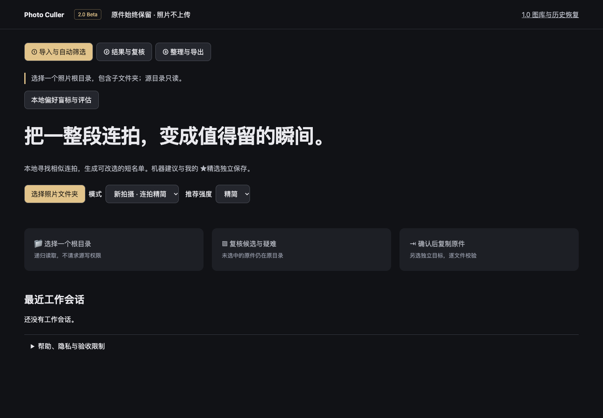

# Photo Culler 2.0 Beta

纯网页、本地处理的连拍短名单工具。照片、路径、EXIF 和审核不会上传；原件不删除、不自动移动。默认入口是三工作区；[1.0 图库和历史恢复](web/legacy.html)完整保留。



1. **导入与自动筛选**：一次选择一个根目录，递归子目录，只申请读取权限。不同目录的会话分别保存在本浏览器。选模式与宽松/标准/精简强度。
2. **结果与复核**：默认只显示机器候选和疑难组。可一键采纳短名单，保存本次输出计划；撤销或修改候选后需重新采纳。人工保留、暂不导出、稍后复核和独立 ★精选优先于机器。切“查看所有”展开其余照片。勾选 2–4 张比较，滚轮缩放、拖动平移；可同步/独立操作，J/K 浏览、1 精选、2 保留、X 暂不导出、3 稍后复核、U 撤销、F 全屏、Esc 关闭。
3. **整理与导出**：预览照片组、物理文件、总字节、完整相对路径及未分析清单。选择与源不重叠的独立目标，再单独确认复制。可显式附带未分析文件。输出是 `PhotoCull_Output_<时间>_<随机标识>/Keepers/<原路径>` 与 `Reports/`。逐文件 SHA-256 校验成功后才报告完成；下载报告不等于照片已导出。

JPEG/PNG/WebP 可分析；HEIC 取决于浏览器解码。RAW-only、视频、Live Photo 配套和失败项保护并列出。按同目录同 stem 绑定 RAW/JPEG/XMP，不混合不同子目录同名文件。历史输出与恢复目录不参与新扫描。无真实 EXIF 拍摄时间时不以 mtime 假装拍摄时间；精确相同内容仍可形成重复候选。比较网格每页最多 60 组；图像分析逐张在 Worker 中执行，关闭比较释放 URL；原图 1:1 按需加载，超过总计 128MiB 解码预算时保留 1600px 预览并说明降级。

本地偏好标注入口支持导入 AI 代理草稿、优先核对不确定项、逐张确认及下载冻结评估。详见 [标注与评估流程](docs/photo-culler-2-labeling.md)。AI 代理标签与真人盲测分开记录，均不改变导出决定。

## 开发与验收

Node 22.12+（实际验证 22.22.0）：

```sh
npm ci
npm run check
npm test
npm run test:dist
npm run dev
```

Vite 8.3.6 只做静态打包，`web/ → dist/`；GitHub Pages base 固定 `/photo-culler-static/`。`test:dist` 包含 build 和真实子路径预览检查。旧测试仅更换到保留的 `legacy.html` 路由，并按冻结约束更新“只读权限”和“多会话不丢旧审核”两个旧合同。

PR check 和 main 发布都必须通过 ci/check/test/build/dist 冒烟。发布只允许 main；本功能分支不会部署生产。详见 [验收记录与未完成矩阵](docs/photo-culler-2-validation.md)、[架构决定](docs/adr/0002-culler-2-sessions-and-copy.md)、[第三方许可](THIRD_PARTY_NOTICES.md)。

## 限制

当前是规则版 Beta 候选代码，不是 Stable。人像模型因遥测门槛未通过而不安装；embedding 无经过验证的小模型/收益数据，延期。连拍阈值尚无用户 S9 盲测，95% 召回与 70% 减少看片量均未验证。编辑版/裁剪、全景、艺术虚焦、表情与故事性不能可靠自动判定，请使用宽松推荐或全量复核。

Mac Chrome 的自动测试使用隔离 OPFS 合成副本，不代表真实外部相机目录或 Windows Edge 验收。新流程不提供文件移动；旧页面仅允许已验证原生 OPFS 移动/恢复。外部目录历史批次仍可发现，无法安全恢复时明确报错并保持原样。权限拒绝、空间不足或冲突会中止，不覆盖不同内容。未完成输出保留已写字节和 journal；同页可下载记录，重新确认创建新输出目录。重开同一会话后可“继续上次中断导出”，重新授权输出并逐文件校验；已有不同内容或不完整文件冲突时停止，请选择新输出目录。

浏览器存储清理会失去会话，源照片与磁盘 journal 不受影响。项目尚无仓库级 LICENSE，不能替所有者新增授权；依赖许可证已保留。

<details><summary>1.0 历史使用与性能说明</summary>

# Photo Culler Local

一个部署到 HTTPS 静态服务器的本地照片初筛工具。运行时只有 HTML、CSS 和浏览器 JavaScript：照片、路径、技术分数与筛选进度都保留在你的电脑上，网站不会上传或接收照片。

## 支持范围

- macOS 上的 Chrome 或 Edge。
- 必须从 HTTPS 静态站点打开；`file://` 和普通 HTTP 不是受支持方式。
- 首次选择、重新打开页面或浏览器撤销授权后，浏览器会要求你重新授予照片目录的读写权限。
- Safari、Firefox、移动端、RAW 解码、递归扫描、自动永久删除、PWA 与 AI 二次判断不在支持范围内。

## 部署

将 [`web/`](./web/) 目录作为任意静态服务器的站点根目录部署即可。它不需要 Python、Flask、数据库、端口转发、账户或后端 API。

发布后用 HTTPS 域名打开页面，点击“选择照片文件夹”，在系统选择器中选择一个已从相机复制到本机的单层目录。浏览器只会在你选择的目录范围内读取或写入文件。

## 使用与安全边界

1. 页面只扫描当前目录的 JPEG/PNG/WEBP；同 stem 的 `.JPG/.JPEG/.PNG/.WEBP`、`.RW2` 与 `.XMP` 是一个 **照片组（photo group）**。RAW-only 文件不会显示，RW2/XMP 不会被解码。
2. 浏览器 worker 对 JPEG/PNG/WEBP 做保守技术初筛。全黑、全白、低清晰度和无法读取的照片会进入人工确认范围；分数不作构图或审美淘汰。
3. `1 / 2 / X` 保存精选、保留和建议移出决定，并移动到可见队列中的相邻下一张；`Space / J` 只跳到整个照片队列中的下一张未筛项目。
4. `C` 将当前完整照片组加入或移出操作选择。点击“移动已选项”并确认具体目标目录、照片组数与文件数后，全部成员会移动到同目录的 `_PhotoCull_Review_*/`。
5. 移动前和每个成员移动后，网页都会把 `move-manifest.json` 写入该可恢复批次。刷新、关闭网页或中断后，重新选择源目录即可发现该批次并整批或单组恢复。
6. 恢复从不覆盖源目录中后来出现的同名文件；出现冲突时会停止并保留现状，供你人工处理。

工作区显示“已筛 / 总数”和当前筛选数量。继续上次筛选会恢复上次大图；如果已关闭大图，则恢复网格滚动位置。临时的操作选择不会跨会话恢复。

审核决定会立即显示，并按顺序保存到浏览器本地存储；`U` 撤销最近一次决定变更。保存失败时，大图或工作区会显示“重试保存”，当前决定仍保留在本页。切换目录、移动和恢复会等待保存完成；保存失败后需先重试。尚有未保存决定时，离开页面会触发浏览器提醒。

目录打开、移动和恢复互相排斥，避免文件操作交错。权限和读取错误会保留原始原因，不会被当作文件不存在。

`move-manifest.json` 是文件恢复的权威记录；IndexedDB 只保存缩略图、技术分析和审核界面进度。清理浏览器数据可能要求你重新选择目录，但不会删除照片目录内的可恢复批次。

## 性能与资源边界

- 同一时间只允许一轮目录分析。选择其他目录会取消旧信号、终止旧 worker，并忽略所有迟到的进度和结果。
- 照片网格和大图胶片栏按视口虚拟化，只渲染可见范围及缓冲区；滚动、键盘导航和跨范围选择仍覆盖完整队列，不需要分批加载按钮。
- 逐项分析通过 photo group ID 索引更新，保留对象身份；可见队列与导航位置在决定、筛选和目录成员变化时更新，普通切图复用已有队列。
- photo grid 与 filmstrip 分别管理缩略图 URL；退出各自显示范围的缩略图会释放，状态更新继续复用未变化的预览。
- 大图先显示已有缩略图，再替换为全分辨率预览；最多保留当前及相邻共 3 张预览，且仅预加载不超过 800 万像素的邻图。大尺寸相机照片不做邻图预解码。关闭后释放大图与胶片栏资源。
- 已移动预览一次只降采样一张；关闭面板会让尚未开始的队列任务失效。
- IndexedDB v3 分析缓存按目录句柄身份与算法版本隔离，最多保留 2,000 条。升级会清除旧版未隔离的技术分析缓存，保留目录句柄及人工审核决定；旧算法分数会重新计算。
- 分析优先处理当前大图、相邻照片及网格可见项；缩略图先于评分结果返回，缓存写入最多同时 2 个，完成统计包含缓存写入等待。
- 默认使用 CPU Worker；优化后的长边缩放不放大小图，清晰度统计合并扫描。WebGPU 保留为独立开发实验，不进入生产分析流程或缓存。

这些边界用于控制长目录的同时解码量、DOM 数量与长期本地缓存增长；实际峰值内存仍取决于照片分辨率、压缩大小与 Chrome 的图像缓存策略。

分阶段计时涵盖解码、评分、缩略图、缓存读写及首个预览/结果；诊断为显式启用，不包含文件名、路径或像素。[CPU 与调度测量](docs/research/analysis-performance.md)及[本地 GPU 评估](docs/research/local-gpu-evaluation.md)保留原始证据。GPU 实验只读回少量统计值，但生成的 24MP 图片测试未达到采用门槛，因此仍以 CPU 为默认。这些合成数据不能代表真实相机目录的速度、屏幕首帧或峰值内存。

## 本地验证

需要 Node.js 22 或更高版本：

```bash
npm test
npm run check
```

`npm test` 会运行内存测试和 Chrome 端到端测试。后者以静态服务器提供 `web/`，在浏览器的隔离本地文件系统中创建 JPEG/PNG/WEBP/RW2/XMP 测试副本，验证 worker 分析、完整移动、恢复、内容与修改时间保持以及无照片网络请求；它不会打开或写入你的照片目录。

发布前仍建议在 Chrome/Edge 中选择一个复制的测试目录，人工确认原生目录授权流程与系统文件选择器行为。

</details>
